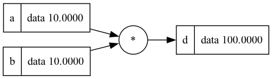

# graph-grad
---
A small autograd engine in C++. Every operation on a `V<T>` value remembers its
inputs and how to pass the gradient back to them, so after building an expression
you can call `backward()` and read the gradient of every input. The computation
graph can be exported to a text file and plotted with Python.

## Project layout

```
include/val.hpp        V<T> value type, operators, backward(), minimize()
include/graph.hpp      value_node tree + export API
src/graph.cpp          buildGraphFromV(), saveGraphToFile()
main.cpp               example expression
scripts/parse_graph.py reads a .gr file into Python Node objects
scripts/plot_graph.py  plotGraphFromRoot() - renders the graph with Graphviz
run.py                 parse + plot in one command
graphs/                exported .gr files
assets/                rendered images
```

## Requirements

- CMake >= 3.16 and a C++20 compiler
- Python >= 3.10
- [Graphviz](https://graphviz.org) (`brew install graphviz`) - provides the `dot` program used for plotting, no pip packages needed

## Build and run

```sh
cmake -S . -B build
cmake --build build
./build/mygrad            # writes graphs/graph.gr (run from the project root)
```

## Plotting the graph

```sh
python3 run.py <file.gr> <output name> <format>
python3 run.py graphs/graph.gr assets/graph png   # -> assets/graph.png
python3 run.py                                    # defaults: graph.gr -> graph.svg
```

Run it from the project root so the `scripts` package can be imported.

## Example

[main.cpp](main.cpp) builds

```
L = ((a * b + c) * (a - d)) * (f * g + a)
```

with `a = 2`, `b = -3`, `c = 10`, `d = 4`, `f = -2`, `g = 3`, calls
`L.backward()` and exports the graph:

```cpp
V<double> e = a * b;  e.setLabel("e");   // -6
V<double> h = e + c;  h.setLabel("h");   //  4
V<double> k = a - d;  k.setLabel("k");   // -2
V<double> m = h * k;  m.setLabel("m");   // -8
V<double> n = f * g;  n.setLabel("n");   // -6
V<double> p = n + a;  p.setLabel("p");   // -4
V<double> L = m * p;  L.setLabel("L");   // 32

L.backward();
auto root = buildGraphFromV(L);
std::string filename = "graphs/graph.gr";
saveGraphToFile(std::move(root), filename);
```

Rendered with `python3 run.py graphs/graph.gr assets/graph png`:




`a` appears three times in the picture because the exported graph is a tree:
every use of a value gets its own copy. All copies show the same total gradient.

## How it works

1. **Build the expression** - `a * b` returns a new `V` whose children are
   pointers to `a` and `b`, with operation `MUL` and a gradient function.
2. **Convert to a tree** - `buildGraphFromV` walks the child pointers and copies
   each value into a `value_node` that owns its children via `unique_ptr`.
3. **Export** - `saveGraphToFile` writes one line per node, leaves first and the
   root last:

   ```
   b | 10.000000 | 10.000000 | none | none | none
   a | 10.000000 | 10.000000 | none | none | none
   d | 100.000000 | 1.000000 | * | a | b
   ```

   Columns are `label | data | grad | operation | left child | right child`.
   Call `backward()` on the root before exporting, otherwise every grad is 0.
4. **Parse** - `scripts/parse_graph.py` splits each line on `|` and creates a
   `Node`. Children are linked by label; because leaves come first, a node's
   children already exist when it is read. The last node is the root.
5. **Plot** - `plotGraphFromRoot` walks from the root and generates Graphviz DOT
   (boxes for values, circles for operations), then pipes it to `dot`.

## Known limitations

- **Name every intermediate result.** In `V d = a * b + c;` the result of `a * b`
  is a temporary that is destroyed at the end of the line, but `d` keeps a raw
  pointer to it. Write `V ab = a * b; V d = ab + c;` instead.
- **Give every node a unique label** (`setLabel`). The Python parser links nodes by
  label, so empty or duplicate labels can connect the wrong nodes.

